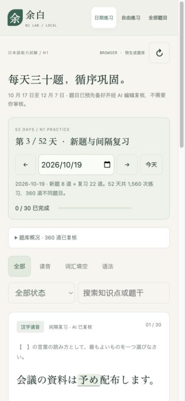

# Vercel 子目录静态访问修复

问题：页面位于 `/jlpt-n1-lab/web/`，但CSS和脚本使用 `/style.css`、`/app.js`，错误指向域名根目录。即使只修复这些地址，原本依赖本机Python的 `/api/state` 和POST接口仍不能工作。

变更：

- CSS、脚本、品牌链接改为相对路径；导出由应用内下载处理，不再链接根目录API。
- 新增 `web/storage.js`：在本机根地址保留Python/SQLite接口，静态站点则直接读取已有 `data/candidates.json` 和 `data/study-plan.json`。
- 线上作答、收藏与疑问保存到当前站点的浏览器localStorage。不同设备和浏览器不自动同步，清除网站数据会删除记录；页面明确说明并支持导出JSON备份。
- 已有个人SQLite数据库未上传，也不导入线上静态数据；用户原有3条本机作答保留。
- 题目内容、审核记录和52天计划没有修改，也无需调用LLM。

验证：

- 7项JavaScript存储测试通过：子目录URL、东京日期、持久化、日期进度去重、版本及题单验证、疑问撤回、导出、存储失败提示和本机API模式。
- 22项原有Python测试通过，JavaScript语法检查通过。
- 与Vercel相同的子目录结构实际HTTP验证：CSS、app.js、storage.js、题库和计划均200；Python本机 `/storage.js` 与 `/api/state` 仍200。
- 隔离静态预览浏览器验证：360题、52天计划、作答、中文解析、收藏、刷新保留进度并选择未做题，以及真实下载JSON备份。测试记录仅位于预览端口的独立浏览器存储中。
- 390像素手机视口检查样式与12月7日全复习题单。

线上入口：[余白 N1](https://mintbtw.vercel.app/jlpt-n1-lab/web/)。此静态模式无需Vercel数据库或Python运行服务。

## 正式部署验证

GitHub代码提交 `6d3f441` 对应的Vercel Production部署成功。正式域名HTML使用相对路径；style.css、app.js、storage.js均返回200且SHA-256与仓库文件一致。浏览器在正式网址成功加载360题、东京日期当天30题和中文题干，390像素视口样式正常。没有往正式站点写入测试答题；保存、收藏与下载验证在独立本地预览来源完成。

